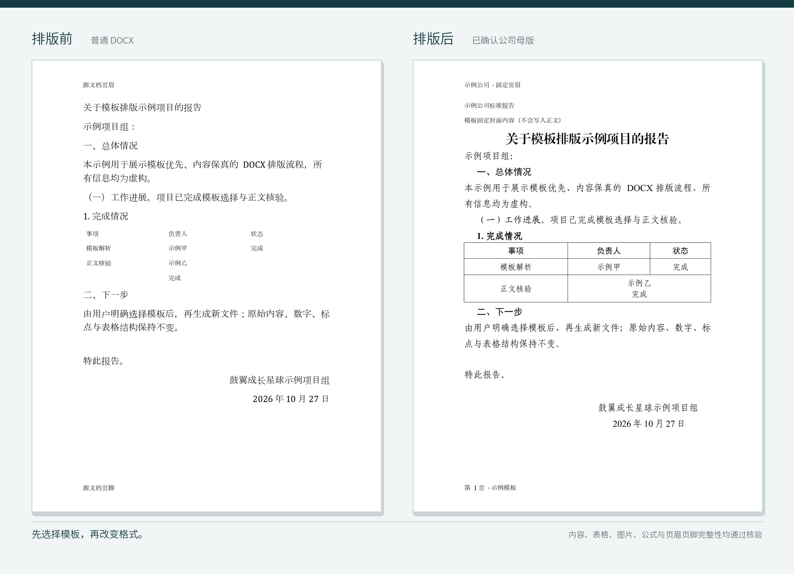

<div align="center">

<sub>鼓翼成长星球 · Word 模板排版 Skill</sub>

# Word 模板排版

> 先选模板，再改格式。

把单位的 DOCX/DOTX 模板交给 Agent：先解析版式，再由你确认、命名和保存。之后每次排版都必须明确选择 GB/T 9704 参考版或一套已保存模板，输出新 DOCX、排版报告和核验报告。

[](https://github.com/ianlinkstudy/formal-docx-template-formatter/releases)
[](https://github.com/ianlinkstudy/formal-docx-template-formatter/actions/workflows/tests.yml)
[](LICENSE)
[](https://skills.sh)

```bash
npx skills add ianlinkstudy/formal-docx-template-formatter
```

[能做什么](#能做什么) · [安装](#安装与第一次使用) · [导入单位模板](#导入单位模板) · [核验边界](#核验什么) · [下载](#版本与下载)

</div>

---

<p align="center">
  
</p>

<p align="center"><sub>左侧是未排版的虚构源文件；右侧是导入并确认公司母版后的输出。正文、表格和页眉页脚均通过完整性核验。</sub></p>

## 为什么需要它

直接说“按我们公司的模板排版”，常见结果只有两种情况：

1. Agent 只看了一眼截图，靠字体和页边距猜了一套近似版式；
2. 模板细节被忽略，正文、表格、图片或公式却发生了意外变化。

这个 Skill 把流程拆成两个明确阶段：

- **导入模板**：解析 DOCX/DOTX → 展示中文摘要 → 用户明确确认 → 命名 → 保存；
- **排版正文**：先选择模板 → 生成新 DOCX → 独立核验内容与版式。

候选模板未经确认、确认后又被修改、尚未命名或保存失败时，都不能出现在排版模板列表中。

## 能做什么

| 任务 | 输出 | 关键保护 |
|---|---|---|
| 用 GB/T 9704 参考版排版 | 新 DOCX + 排版报告 + 核验报告 | 正文、表格、页眉页脚、图片和公式内容不变 |
| 导入公司 DOCX 样式模板 | 本地保存的自定义模板 | 解析摘要必须由用户明确确认 |
| 导入带 `{{BODY}}` 锚点的母版 | 固定封面、页眉页脚和模板文案 + 新正文 | 锚点唯一、正文范围可追溯 |
| 用已保存模板排版 | 新 DOCX + 两份 JSON 报告 | 每次任务都必须重新选择模板 |
| 管理模板 | 最多 3 套有效模板，可归档、恢复和重命名 | 归档模板不占槽位，但不能用于排版 |

### 两种模板模式

| 模式 | 适用场景 | 行为 |
|---|---|---|
| 样式模式 `style` | 普通 DOCX 模板，没有正文占位符 | 提取页面、段落角色、字体、字号、行距、缩进和表格规则 |
| 母版模式 `shell` | 带固定封面、页眉页脚或模板文案的 DOCX/DOTX | 保留母版固定内容，把源文档迁移进唯一的 `{{BODY}}` 或用户确认的范围 |

母版锚点支持：

```text
{{TITLE}} / {{标题}}
{{RECIPIENT}} / {{主送机关}}
{{BODY}} / {{正文}}
{{SIGNATURE}} / {{落款}}
{{DATE}} / {{日期}}
```

`BODY` 必须存在且唯一；其余锚点可选，最多出现一次。

## 安装与第一次使用

需要 **Python 3.10 或更高版本**。

### 1. 安装 Skill

```bash
npx skills add ianlinkstudy/formal-docx-template-formatter
```

也可以手动放入支持 Skills 的目录，例如：

```text
~/.codex/skills/formal-docx-template-formatter/
```

安装目录不能只有 `SKILL.md`。至少应包含：

```text
profiles/      内置 GB/T 9704 参考版
scripts/       模板管理、排版、核验和预览
references/    状态机、Profile 字段与富对象规则
tests/         自动测试
```

### 2. 安装 Python 依赖

在 Skill 根目录运行：

```bash
python3 -m pip install -r requirements.txt
```

### 3. 先列模板，再开始排版

```bash
python3 scripts/template_cli.py list
```

第一次使用只有内置的 `GB/T 9704-2012 参考版`。如果这份文件不能直接使用 GB 版式，先导入单位模板，不要让 Agent 猜。

### 4. 用选定模板排版

```bash
python3 scripts/format_docx.py 输入.docx 输出.docx \
  --template "模板名称"
```

命令会在生成前做一次独立核验。正常交付还会包含：

```text
输出.docx.format-report.json
输出.docx.verify-report.json
```

需要再次单独核验时：

```bash
python3 scripts/verify_docx.py 输出.docx \
  --reference 输入.docx \
  --template "模板名称"
```

只有命令成功、`format-report.json` 显示语义完整性通过，且 `verify-report.json` 的 `status` 为 `passed` 时，才应交付结果。

详细操作见 [中文使用手册](docs/usage-guide.zh-CN.pdf) · [Markdown 源稿](docs/usage-guide.zh-CN.md)。

## 导入单位模板

### 1. 解析

```bash
python3 scripts/template_cli.py inspect 单位模板.docx --mode auto
```

`auto` 会优先识别母版锚点；没有锚点时按普通样式模板提取规则。

返回的 `candidate.summary` 是供用户确认的唯一摘要来源。确认摘要至少覆盖：

- 页面和页边距；
- 标题、正文与分级标题；
- 表格样式；
- 模板模式；
- 母版锚点；
- 低置信度项；
- 阻断项。

### 2. 修正解析

修改字体、字号或行距：

```bash
python3 scripts/template_cli.py amend CANDIDATE_ID \
  --changes-json '{"profile":{"styles":{"body":{"size_pt":12,"line_rule":"multiple","line_value":1.5}}}}'
```

修改母版正文范围：

```bash
python3 scripts/template_cli.py amend CANDIDATE_ID \
  --mode shell --body-start 3 --body-end 12
```

任何修正都会清空旧确认并生成新的 `candidate_sha256`。

### 3. 明确确认

只有用户明确说出“确认解析结果”或同义且无歧义的话，才能确认：

```bash
python3 scripts/template_cli.py confirm CANDIDATE_ID \
  --candidate-sha256 SHA256 \
  --user-confirmation-text "确认解析结果"
```

上传模板、沉默、说“先看看”、要求修改或直接要求排版，都不等于确认。

### 4. 命名并保存

确认成功后才询问模板名称：

```bash
python3 scripts/template_cli.py save CANDIDATE_ID \
  --name "集团年度报告"
```

名称最多 32 个字符，不能与当前有效模板重名。保存成功后结束导入流程；不要在同一轮自动拿新模板开始排版。

### 5. 管理模板

```bash
python3 scripts/template_cli.py show "集团年度报告"
python3 scripts/template_cli.py rename "集团年度报告" "集团正式报告"
python3 scripts/template_cli.py archive "旧模板"
python3 scripts/template_cli.py restore "旧模板"
```

默认本地模板库位于：

```text
~/.formal-docx-template-formatter/
├── pending/    未确认候选
├── templates/  已确认并保存的有效模板
└── archive/    已归档模板
```

## 核验什么

核验不是“看起来差不多”，而是比较源文档和输出文档的实际 OOXML 结构：

- 每个段落文字和顺序；
- 顶层、合并和嵌套表格结构；
- 每个表格单元格文字；
- 页眉、页脚里的段落和表格；
- 行内图片与媒体部件哈希；
- OMML 公式 XML 哈希；
- Equation/MathType OLE 对象和嵌入部件哈希；
- 页面、字体、字号、固定行距、对齐和字符缩进；
- 表格边框、单元格留白、列宽和重复表头。

允许变化的只有模板声明的排版属性、表格列宽和超宽行内图片尺寸。图片保持比例，不裁剪、不旋转、不重编码。

## 支持与限制

| 支持 | 首版不承诺 |
|---|---|
| `.docx` 和 `.dotx` 模板 | `.docm`、`.doc`、PDF、扫描件 |
| 单节正文 | 多节源文档的母版合并 |
| 样式模板与锚点母版 | 未确认的正文范围自动猜测 |
| DOCX 内表格、图片、OMML 和 OLE 完整性检查 | 浮动对象的自动重排 |
| 最多 3 套有效自定义模板 | 无上限的模板库 |

`.docm`、`.doc`、PDF 和扫描件应先转换为可编辑 DOCX，并人工核对转换结果。

## 隐私、安全与边界

- 排版、核验和预览默认在本机完成；
- 不上传用户 DOCX，不读取远程模板，不发送 telemetry；
- 不覆盖输入文件，输出必须写入不同路径；
- 不把用户模板写入公开分享包；
- 不随包分发字体文件；
- 不重写、润色、翻译或补全正文；
- 不新增红头、文号、印章、版记、页码或附件；
- 不把一次脚本成功解释为法定公文合规结论。

安全说明见 [SECURITY.md](SECURITY.md)。
公开 PDF 使用的开源字体说明见 [THIRD_PARTY_NOTICES.md](THIRD_PARTY_NOTICES.md)。

## 开发与测试

```bash
python3 -m pip install -r requirements-dev.txt
python3 -m unittest discover -s tests -v
```

示例均为虚构、脱敏材料。重建示例并核验：

```bash
python3 examples/build_examples.py
```

重建首页对比图、使用手册和 Release 资产：

```bash
python3 examples/build_showcase.py
python3 docs/build_usage_pdf.py
python3 scripts/build_release.py
```

发布前请同时更新 `VERSION`、`CHANGELOG.md`、`docs/iterations.md` 和 `docs/release-notes-v1.0.0.md`。

## 版本与下载

当前版本：**1.0.0**

- [查看最新 Release](https://github.com/ianlinkstudy/formal-docx-template-formatter/releases/latest)
- [下载 ZIP 安装包](https://github.com/ianlinkstudy/formal-docx-template-formatter/releases/latest/download/formal-docx-template-formatter-v1.0.0.zip)
- [下载 `.skill` 包](https://github.com/ianlinkstudy/formal-docx-template-formatter/releases/latest/download/formal-docx-template-formatter-v1.0.0.skill)
- [下载中文使用手册](https://github.com/ianlinkstudy/formal-docx-template-formatter/releases/latest/download/formal-docx-template-formatter-v1.0.0-usage-guide.zh-CN.pdf)
- [查看更新日志](CHANGELOG.md)

### 仓库结构

```text
formal-docx-template-formatter/
├── SKILL.md
├── README.md
├── VERSION
├── CHANGELOG.md
├── agents/
├── profiles/
├── scripts/
├── references/
├── examples/
├── docs/
└── tests/
```

## 许可

代码和文档采用 [MIT License](LICENSE)。个人使用和商业使用均可，分发时请保留许可证声明。

---

<div align="center">

**鼓翼成长星球 · 出品与持续维护**

模板先确认，正文再排版。

</div>
